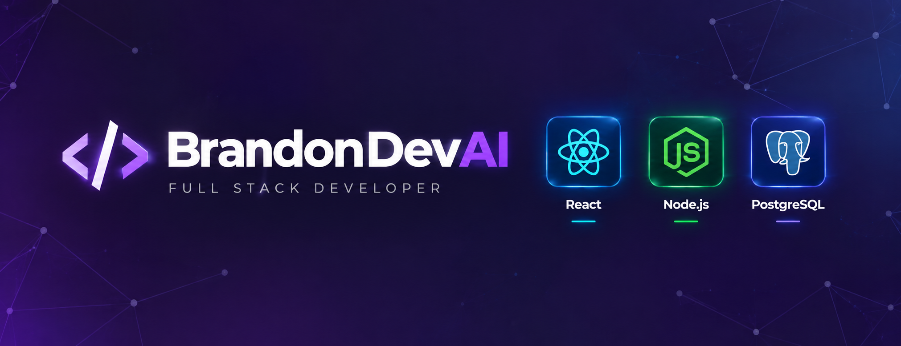
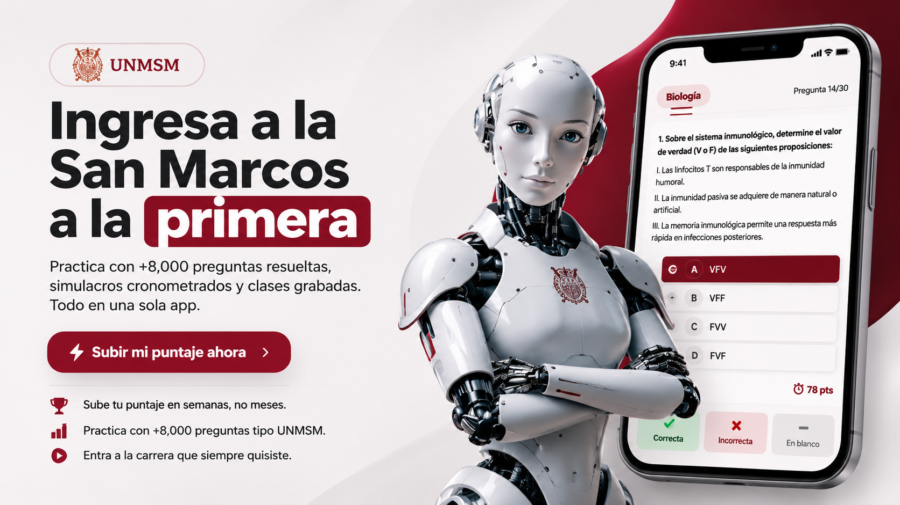
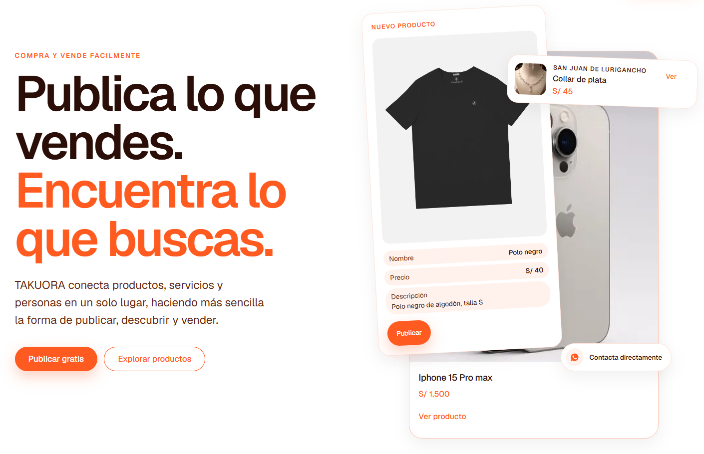
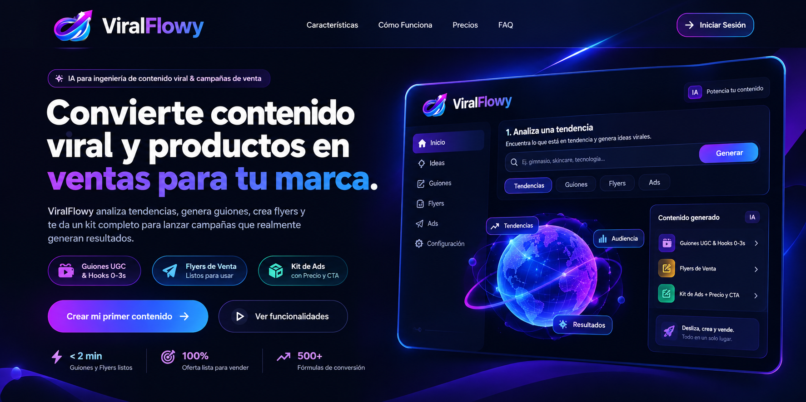

<h1 align="center">Hola, soy <a href="https://brandon-dev.vercel.app/">BrandonDevAI</a> 👋</h1>

---

## Sobre mí

- 🚀 Desarrollo aplicaciones Full Stack modernas, escalables y responsive.

- ⚛️ Construyo interfaces intuitivas con React, Next.js y TypeScript.

- ⚙️ Diseño APIs y servicios backend con Node.js, NestJS y FastAPI.

- 🗄️ Trabajo con bases de datos relacionales como PostgreSQL y MySQL.

- ☁️ Implemento soluciones con Docker, AWS y pipelines CI/CD.

- 🤖 Exploro la integración de IA y la automatización para resolver problemas reales.

---

## Stack tecnológico

   
 

 

## Proyectos *Destacados*

  <table>
    <tr>
      <td width="100%" align="center">
        <h3 align="center">SanMarcos Go</h3>
        
        

          
                    
        

        

          Ayuda a los postulantes a prepararse para el examen de admisión <strong>para el examen de admisión </strong> - Hecho para @estudiantes <strong>con práctica y seguimiento de su progreso.</strong>.
        

      </td>
    </tr>
  </table>

 

<table>
<tr>
<td width="50%">
<h3 align="center">Takuora</h3>

Facilita la publicación, el descubrimiento y la venta de productos <strong>la venta de productos</strong> - mediante una experiencia de marketplace simplificada.

                                                                                      
</td>

<td width="50%">
<h3 align="center">ViralFlowy</h3>

                                       

Automatiza la creación de <strong>contenido y campañas con Inteligencia Artificial</strong> para ahorrar tiempo y apoyar los objetivos de marketing.

                                                             
</table>                                                                                 

 
